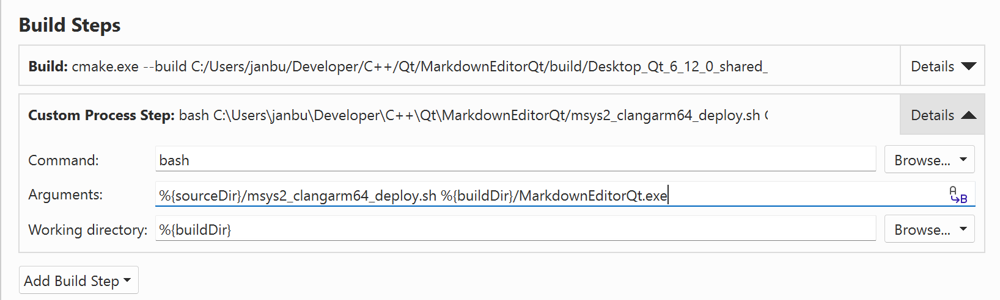

### MSYS2 & Qt Creator custom build step

On Windows/MSYS2, creating a deployment bundle is as simple as adding a custom build step in Qt Creator and using the provided CLANGARM64 or UCRT64 scripts.

**Command:** bash
**Arguments:** %{sourceDir}/msys2_clangarm64_deploy.sh %{buildDir}/MarkdownEditorQt.exe
or
**Arguments:** %{sourceDir}/msys2_ucrt64_deploy.sh %{buildDir}/MarkdownEditorQt.exe
**Working directory:** %{buildDir}

